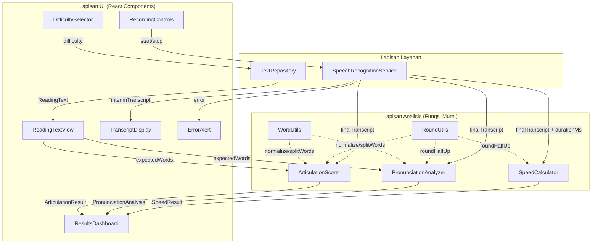
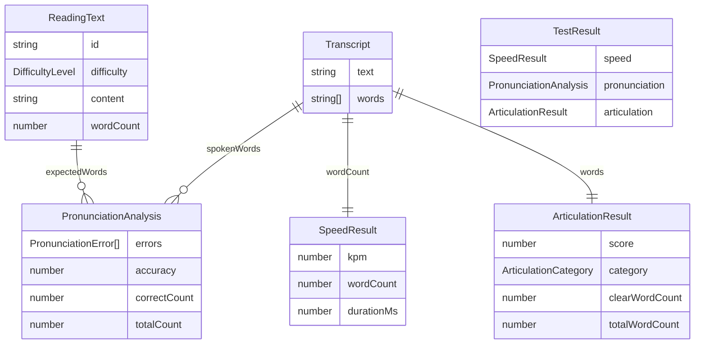

# Design Document

## Overview

Dokumen ini mendefinisikan desain teknis untuk fitur Situs Tes Kecepatan Membaca — sebuah aplikasi web sisi-klien yang memungkinkan Pengguna melakukan tes membaca nyaring. Situs menampilkan Teks_Bacaan sesuai tingkat kesulitan yang dipilih, menangkap ucapan Pengguna melalui mikrofon menggunakan Web Speech API, lalu menghitung kecepatan membaca dalam KPM (Kata Per Menit), menganalisis kesalahan pengucapan dengan membandingkan kata yang diucapkan terhadap kata yang diharapkan secara posisi-demi-posisi, menilai kejelasan artikulasi, dan menampilkan seluruh hasil dalam satu Dashboard_Hasil yang terpadu.

### Pilihan Teknologi

| Aspek | Pilihan | Alasan |
|-------|--------|--------|
| Bahasa | TypeScript | Keamanan tipe untuk model data yang terstruktur (Transkrip, hasil analisis) |
| Framework UI | React 18 + Vite | Arsitektur berbasis komponen, build cepat, dukungan hook untuk state microphone |
| Pengenalan Ucapan | Web Speech API (SpeechRecognition) | API bawaan browser, tidak perlu server eksternal, mendukung transkrip parsial |
| Pengujian Unit | Vitest | Terintegrasi dengan Vite, cepat, sintaks mirip Jest |
| Pengujian Properti | fast-check | Pustaka PBT standar untuk JS/TS, runner-agnostic, kompatibel dengan Vitest |
| Styling | CSS Modules | Scope lokal, tidak konflik kelas, cocok untuk komponen React |

### Keputusan Desain Utama

1. **Pemisahan logika analisis dari UI**: Semua perhitungan (KPM, analisis pengucapan, skor artikulasi) diimplementasikan sebagai fungsi murni yang terpisah dari komponen React. Ini memungkinkan pengujian properti-based tanpa bergantung pada DOM atau Web Speech API.

2. **Pengenalan ucapan sisi-klien**: Menggunakan Web Speech API bawaan browser. Tidak ada server backend — seluruh pemrosesan terjadi di browser Pengguna. Audio dikirim ke layanan pengenalan cloud browser secara default (mis. layanan Google untuk Chrome).

3. **Perbandingan kata berbasis posisi**: Sesuai persyaratan, kata diucapkan dibandingkan terhadap kata diharapkan pada posisi yang sama. Ketika jumlah kata berbeda, kata tanpa pasangan ditandai sebagai kesalahan. Ini lebih sederhana daripada alignmen Levenshtein penuh dan sesuai dengan rumusan persyaratan ("posisi yang sama").

4. **Normalisasi kata**: Perbandingan kata bersifat case-insensitive (tanpa memperhatikan huruf besar/kecil) sesuai Requirement 4.2. Kata dinormalisasi menjadi huruf kecil dan tanpa tanda baca sebelum perbandingan.

## Architecture

Aplikasi adalah single-page application sisi-klien dengan tiga lapisan yang terpisah:



### Alur Data Utama

1. **Pemilihan teks**: Pengguna memilih kesulitan → `TextRepository` menyediakan `ReadingText` → ditampilkan oleh `ReadingTextView`
2. **Perekaman**: Pengguna klik mulai → `SpeechRecognitionService` memulai `SpeechRecognition` → transkrip parsial ditampilkan real-time oleh `TranscriptDisplay`
3. **Penghentian**: Pengguna klik berhenti → `SpeechRecognitionService` menghentikan pengenalan, menghitung durasi, mengembalikan `Transcript` lengkap
4. **Analisis**: `Transcript` + `ReadingText` dimasukkan ke `SpeedCalculator`, `PronunciationAnalyzer`, dan `ArticulationScorer` secara paralel
5. **Tampilan hasil**: Ketiga hasil digabungkan dalam `TestResult` dan ditampilkan oleh `ResultsDashboard`

## Components and Interfaces

### Komponen UI

#### DifficultySelector
Komponen untuk memilih tingkat kesulitan Teks_Bacaan.

```typescript
interface DifficultySelectorProps {
  onSelect: (difficulty: DifficultyLevel) => void;
  disabled: boolean;
}
```
- Merender tiga pilihan: "Mudah (50-100 kata)", "Sedang (101-200 kata)", "Sulit (201-300 kata)"
- Menonaktifkan pilihan saat perekaman aktif

#### ReadingTextView
Menampilkan Teks_Bacaan beserta jumlah kata, dengan font minimum 16 piksel.

```typescript
interface ReadingTextViewProps {
  readingText: ReadingText | null;
}
```
- Menampilkan paragraf teks dengan ukuran font minimum 16px
- Menampilkan jumlah kata sebagai bilangan bulat
- Menampilkan teks dengan ukuran font minimum 16 piksel

#### RecordingControls
Kontrol mulai dan berhenti perekaman, serta indikator visual perekaman aktif.

```typescript
interface RecordingControlsProps {
  isRecording: boolean;
  onStart: () => void;
  onStop: () => void;
  disabled: boolean;
}
```
- Tombol "Mulai" memicu `onStart`, tombol "Berhenti" memicu `onStop`
- Saat `isRecording` true, menampilkan indikator visual (mis. titik merah berdenyut)

#### TranscriptDisplay
Menampilkan transkrip parsial yang diperbarui real-time dan transkrip lengkap setelah selesai.

```typescript
interface TranscriptDisplayProps {
  interimText: string;      // Transkrip parsial saat perekaman
  finalText: string;        // Transkrip lengkap setelah selesai
  isRecording: boolean;
}
```

#### ResultsDashboard
Menampilkan seluruh hasil tes dalam satu halaman terpadu.

```typescript
interface ResultsDashboardProps {
  result: TestResult | null;
  onRetry: () => void;
}
```
- Bagian atas: ringkasan performa (KPM, Akurasi_Pengucapan, Skor_Artikulasi)
- Bagian bawah: daftar kesalahan pengucapan detail
- Tombol "Ulang" memicu `onRetry`

#### ErrorAlert
Menampilkan pesan kesalahan dengan langkah perbaikan.

```typescript
interface ErrorAlertProps {
  message: string;
  onDismiss: () => void;
}
```

### Komponen Layanan

#### SpeechRecognitionService
Membungkus Web Speech API untuk mengelola siklus pengenalan ucapan.

```typescript
interface SpeechRecognitionService {
  // Memulai pengenalan ucapan, meminta akses mikrofon
  start(lang: string): void;

  // Menghentikan pengenalan dan mengembalikan transkrip + durasi
  stop(): void;

  // Mendaftarkan callback untuk transkrip parsial
  onInterimResult(callback: (text: string) => void): void;

  // Mendaftarkan callback untuk transkrip lengkap dan durasi
  onFinalResult(callback: (transcript: Transcript, durationMs: number) => void): void;

  // Mendaftarkan callback untuk kesalahan
  onError(callback: (error: SpeechRecognitionError) => void): void;
}

type SpeechRecognitionError =
  | { type: 'permission-denied'; message: string }
  | { type: 'no-speech'; message: string }
  | { type: 'not-supported'; message: string }
  | { type: 'unknown'; message: string };
```

Detail implementasi Web Speech API:
- `SpeechRecognition.continuous = true` — pengenalan berkelanjutan selama membaca
- `SpeechRecognition.interimResults = true` — mengembalikan hasil parsial untuk ditampilkan real-time (Req 2.4)
- `SpeechRecognition.lang = 'id-ID'` — bahasa Indonesia
- Event `onresult` memisahkan hasil `isFinal` (transkrip lengkap) vs interim (parsial)
- Event `onerror` dengan `event.error === 'not-allowed'` → kesalahan akses mikrofon (Req 2.3)
- Event `onerror` dengan `event.error === 'no-speech'` → tidak ada ucapan terdeteksi
- Durasi diukur dari `start()` hingga `stop()` menggunakan `performance.now()` atau `Date.now()`

#### TextRepository
Menyediakan Teks_Bacaan berdasarkan tingkat kesulitan.

```typescript
interface TextRepository {
  // Mengembalikan satu Teks_Bacaan untuk tingkat kesulitan yang dipilih
  getText(difficulty: DifficultyLevel): ReadingText;
}
```
- Menyimpan koleksi teks bacaan per tingkat kesulitan
- Jumlah kata tiap teks berada dalam rentang kesulitan: Mudah 50-100, Sedang 101-200, Sulit 201-300

### Komponen Analisis (Fungsi Murni)

#### SpeedCalculator

```typescript
// Menghitung kecepatan membaca dalam KPM
function calculateKPM(wordCount: number, durationMs: number): SpeedResult | SpeedError;
```
- Jika `durationMs === 0`, mengembalikan `SpeedError` (waktu tidak valid, tidak melakukan pembagian dengan nol)
- Jika valid, `kpm = roundHalfUp(wordCount / (durationMs / 60000))`

#### PronunciationAnalyzer

```typescript
// Menganalisis kesalahan pengucapan dengan perbandingan posisi-demi-posisi
function analyzePronunciation(
  spokenWords: string[],
  expectedWords: string[]
): PronunciationAnalysis;
```
- Untuk setiap posisi `i`, membandingkan `spokenWords[i]` dengan `expectedWords[i]` (case-insensitive)
- Jika berbeda, pasangan dimasukkan ke daftar kesalahan
- Jika jumlah kata berbeda, kata tanpa pasangan ditandai sebagai kesalahan dengan `expectedWord` atau `spokenWord` bernilai null
- `accuracy = roundHalfUp(correctCount / expectedWords.length * 100)`

#### ArticulationScorer

```typescript
// Menilai kejelasan artikulasi
function scoreArticulation(
  spokenWords: string[],
  expectedWords: string[]
): ArticulationResult | ArticulationError;
```
- Jika `spokenWords` kosong (Transkrip tidak memuat kata), mengembalikan `ArticulationError`
- `score = roundHalfUp(clearWordCount / spokenWords.length * 100)`
- Kata dianggap "dikenali dengan jelas" jika cocok dengan kata pada posisi yang sama di `expectedWords`
- Kategori: Jelas (80-100), Sedang (50-79), Tidak Jelas (0-49)

#### WordUtils

```typescript
// Menormalisasi kata: huruf kecil, tanpa tanda baca
function normalizeWord(word: string): string;

// Memecah teks menjadi array kata ternormalisasi
function splitWords(text: string): string[];
```

#### RoundUtils

```typescript
// Pembulatan ke bilangan bulat terdekat, 0,5 dibulatkan ke atas
function roundHalfUp(value: number): number;
```

## Data Models

```typescript
// Tingkat kesulitan Teks_Bacaan
type DifficultyLevel = 'Mudah' | 'Sedang' | 'Sulit';

// Teks bacaan yang ditampilkan kepada Pengguna
interface ReadingText {
  id: string;
  difficulty: DifficultyLevel;
  content: string;     // Paragraf teks lengkap
  wordCount: number;   // Jumlah kata sebagai bilangan bulat
}

// Transkrip hasil pengenalan ucapan
interface Transcript {
  text: string;        // Teks transkrip lengkap
  words: string[];     // Array kata ternormalisasi dari transkrip
}

// Hasil perhitungan kecepatan membaca
interface SpeedResult {
  kpm: number;           // Kata Per Menit (dibulatkan)
  wordCount: number;     // Jumlah kata dalam Transkrip
  durationMs: number;    // Waktu tempuh dalam milidetik
}

// Kesalahan waktu tempuh tidak valid
interface SpeedError {
  type: 'invalid-duration';
  message: string;     // "Waktu tempuh tidak valid"
}

// Satu kesalahan pengucapan
interface PronunciationError {
  position: number;                   // Posisi indeks dalam perbandingan kata
  expectedWord: string | null;        // Kata_Diharapkan (null jika tidak ada pasangan)
  spokenWord: string | null;          // Kata_Diucapkan (null jika tidak ada pasangan)
}

// Hasil analisis pengucapan
interface PronunciationAnalysis {
  errors: PronunciationError[];   // Daftar kesalahan pengucapan
  accuracy: number;               // Akurasi_Pengucapan dalam persentase (dibulatkan)
  correctCount: number;            // Jumlah kata benar
  totalCount: number;              // Jumlah seluruh Kata_Diharapkan
}

// Hasil penilaian artikulasi
interface ArticulationResult {
  score: number;                              // Skor_Artikulasi 0-100
  category: ArticulationCategory;             // Kategori kejelasan
  clearWordCount: number;                      // Jumlah kata dikenali jelas
  totalWordCount: number;                      // Jumlah seluruh kata dalam Transkrip
}

// Kesalahan transkrip kosong untuk artikulasi
interface ArticulationError {
  type: 'empty-transcript';
  message: string;   // "Transkrip tidak memuat kata"
}

type ArticulationCategory = 'Jelas' | 'Sedang' | 'Tidak Jelas';

// Hasil tes lengkap yang ditampilkan di Dashboard_Hasil
interface TestResult {
  speed: SpeedResult | SpeedError;
  pronunciation: PronunciationAnalysis;
  articulation: ArticulationResult | ArticulationError;
}
```

### Hubungan Antar Model



## Correctness Properties

*A property is a characteristic or behavior that should hold true across all valid executions of a system — essentially, a formal statement about what the system should do. Properties serve as the bridge between human-readable specifications and machine-verifiable correctness guarantees.*

Properti berikut berlaku untuk fungsi-fungsi murni pada Lapisan Analisis (SpeedCalculator, PronunciationAnalyzer, ArticulationScorer, WordUtils, RoundUtils). Properti tidak berlaku untuk interaksi Web Speech API (layanan eksternal) atau rendering UI, yang diuji dengan integration test dan example-based test.

### Property 1: Teks bacaan memiliki jumlah kata dalam rentang kesulitan

*Untuk setiap* tingkat kesulitan yang dipilih, Teks_Bacaan yang dikembalikan oleh TextRepository HARUS memiliki jumlah kata berada dalam rentang yang ditentukan untuk tingkat kesulitan tersebut (Mudah: 50-100, Sedang: 101-200, Sulit: 201-300), dan jumlah kata tersebut HARUS sama dengan jumlah kata aktual dalam teks (hasil splitWords).

**Validates: Requirements 1.1, 1.2**

### Property 2: Perhitungan KPM sesuai rumus

*Untuk setiap* jumlah kata positif dan waktu tempuh positif dalam milidetik, KPM yang dihitung HARUS sama dengan roundHalfUp(jumlah kata / (waktu tempuh dalam milidetik / 60000)).

**Validates: Requirements 3.1**

### Property 3: Pembulutan setengah ke atas

*Untuk setiap* nilai desimal, roundHalfUp HARUS membulatkan ke bilangan bulat terdekat dengan nilai 0,5 dibulatkan ke atas. Secara khusus, *untuk setiap* bilangan bulat n, roundHalfUp(n + 0,5) HARUS sama dengan n + 1. Fungsi ini HARUS bersifat idempoten: roundHalfUp(roundHalfUp(x)) sama dengan roundHalfUp(x).

**Validates: Requirements 3.2**

### Property 4: Waktu tempuh nol menghasilkan kesalahan

*Untuk setiap* jumlah kata dan waktu tempuh bernilai nol, calculateKPM HARUS mengembalikan SpeedError tanpa melakukan pembagian dengan nol.

**Validates: Requirements 3.3**

### Property 5: Kesalahan pengucapan menangkap seluruh ketidaksesuaian posisi

*Untuk setiap* array kata diucapkan dan kata diharapkan, daftar kesalahan HARUS memuat tepat posisi-posisi di mana perbandingan case-insensitive menunjukkan perbedaan, ditambah kata-kata tanpa pasangan akibat perbedaan panjang array. Setiap kesalahan HARUS memuat expectedWord dan spokenWord (spokenWord bernilai null jika kata diucapkan tidak ada, expectedWord bernilai null jika kata diharapkan tidak ada). Posisi di mana kata cocok secara case-insensitive HARUS tidak muncul dalam daftar kesalahan.

**Validates: Requirements 4.1, 4.2, 4.3, 4.5**

### Property 6: Akurasi pengucapan sesuai rumus

*Untuk setiap* array kata diucapkan dan array kata diharapkan yang tidak kosong, Akurasi_Pengucapan HARUS sama dengan roundHalfUp(jumlah posisi yang cocok secara case-insensitive / jumlah seluruh kata diharapkan * 100).

**Validates: Requirements 4.4**

### Property 7: Skor artikulasi sesuai rumus dan berada dalam rentang

*Untuk setiap* array kata diucapkan yang tidak kosong dan kata diharapkan, Skor_Artikulasi HARUS sama dengan roundHalfUp(jumlah kata dikenali jelas / jumlah seluruh kata dalam Transkrip * 100), dan Skor_Artikulasi HARUS berada dalam rentang 0 hingga 100 inklusif. Sebuah kata dianggap dikenali jelas apabila kata dalam Transkrip cocok secara case-insensitive dengan kata pada posisi yang sama dalam Teks_Bacaan.

**Validates: Requirements 5.1, 5.2**

### Property 8: Kategori artikulasi sesuai ambang batas

*Untuk setiap* Skor_Artikulasi, kategori HARUS sesuai dengan ambang batas: Jelas untuk skor 80 sampai 100, Sedang untuk skor 50 sampai 79, dan Tidak Jelas untuk skor 0 sampai 49.

**Validates: Requirements 5.3**

### Property 9: Transkrip kosong menghasilkan kesalahan artikulasi

*Untuk setiap* kata diharapkan dan array kata diucapkan yang kosong, scoreArticulation HARUS mengembalikan ArticulationError tanpa melakukan pembagian dengan nol.

**Validates: Requirements 5.4**

### Property 10: Normalisasi kata bersifat idempoten

*Untuk setiap* kata, normalizeWord HARUS bersifat idempoten: normalizeWord(normalizeWord(kata)) sama dengan normalizeWord(kata). Normalisasi mengubah huruf menjadi kecil dan menghapus tanda baca, sehingga kata yang telah dinormalisasi tidak boleh berubah jika dinormalisasi kembali.

**Validates: Requirements 4.2**

### Property 11: Akurasi sama dengan skor untuk panjang kata yang sama

*Untuk setiap* array kata diucapkan dan kata diharapkan dengan panjang yang sama dan tidak kosong, Akurasi_Pengucapan HARUS sama dengan Skor_Artikulasi, karena jumlah kata benar sama dengan jumlah kata dikenali jelas, dan jumlah kata diharapkan sama dengan jumlah kata dalam Transkrip.

**Validates: Requirements 4.4, 5.1**

## Error Handling

### Skenario Kesalahan

| Skenario | Penyebab | Penanganan | Persyaratan |
|---------|---------|-----------|-------------|
| Akses mikrofon ditolak | Pengguna menolak izin mikrofon atau browser memblokir akses | Tampilkan ErrorAlert dengan pesan yang menjelaskan langkah mengaktifkan akses mikrofon di pengaturan browser | Req 2.3 |
| Browser tidak mendukung Web Speech API | Browser lama tanpa SpeechRecognition | Tampilkan ErrorAlert dengan pesan bahwa browser tidak mendukung pengenalan ucapan; sarankan gunakan Chrome terbaru | Req 2.1 |
| Tidak ada ucapan terdeteksi | Pengguna tidak berbicara setelah mulai (event `no-speech`) | Tampilkan pesan informasi bahwa tidak ada ucapan terdeteksi; izinkan Pengguna mencoba lagi | Turunan Req 2.3 (pola penanganan kesalahan) |
| Waktu tempuh nol | Pengguna mengaktifkan berhenti segera setelah mulai | SpeedCalculator mengembalikan SpeedError; Dashboard menampilkan indikasi "Waktu tempuh tidak valid" | Req 3.3 |
| Transkrip kosong | Tidak ada kata yang dikenali dari perekaman | ArticulationScorer mengembalikan ArticulationError; Dashboard menampilkan pesan "Transkrip tidak memuat kata" dan tidak menampilkan Skor_Artikulasi | Req 5.4 |
| Jumlah kata tidak sama | Pengguna menambah/menghapus kata saat membaca | PronunciationAnalyzer menandai kata tanpa pasangan sebagai kesalahan; tidak ada kesalahan sistem, hasil tetap dihitung | Req 4.5 |
| Kesalahan pengenalan tak terduga | Kegagalan layanan pengenalan ucapan browser | Tampilkan ErrorAlert dengan pesan kesalahan generik; izinkan Pengguna mencoba lagi | Req 2.3 |

### Strategi Penanganan

1. **Tidak ada pembagian dengan nol**: SpeedCalculator dan ArticulationScorer memeriksa denominator sebelum pembagian. Jika nol, mengembalikan tipe Error alih-alih melakukan pembagian.

2. **Pesan kesalahan yang dapat ditindaklanjuti**: Setiap pesan kesalahan menjelaskan apa yang terjadi dan langkah konkret untuk memperbaikinya (mis. "Aktifkan akses mikrofon di pengaturan browser Anda").

3. **Tidak ada crash pada input tidak valid**: Fungsi analisis menangani input kosong, jumlah kata yang tidak sama, dan teks dengan karakter khusus tanpa melempar pengecualian yang tidak tertangani.

4. **Reset state pada kesalahan**: Kesalahan tidak meninggalkan aplikasi dalam status tidak valid. Pengguna dapat mencoba lagi setelah kesalahan teratasi.

## Testing Strategy

### Pendekatan Pengujian Ganda

Pengujian menggunakan dua pendekatan komplementer:

1. **Pengujian Properti (Property-Based Testing)**: Menguji properti universal di seluruh rentang input yang luas menggunakan fast-check. Setiap properti diuji dengan minimum 100 iterasi untuk menutupi kasus tepi dan variasi input.

2. **Pengujian Unit (Example-Based)**: Menguji contoh spesifik, kasus tepi, dan kondisi kesalahan. Berfokus pada contoh yang mendemonstrasikan perilaku benar, titik integrasi antar komponen, dan kondisi tepi.

### Konfigurasi Pengujian

| Aspek | Konfigurasi |
|-------|------------|
| Runner | Vitest |
| Pustaka PBT | fast-check |
| Minimum iterasi per properti | 100 |
| Tag properti | `Feature: reading-speed-test, Property {n}: {property_text}` |

### Properti yang Diuji (Property-Based Tests)

Properti 1-11 pada bagian Correctness Properties diuji dengan fast-check. Setiap properti:
- Menggunakan generator fast-check untuk input acak (array kata, angka, string)
- Dijalankan dengan minimum 100 iterasi
- Ditandai dengan komentar: `Feature: reading-speed-test, Property {n}: {property_text}`

Pengujian properti berfokus pada Lapisan Analisis (fungsi murni):
- `calculateKPM` — Properties 2, 4
- `roundHalfUp` — Property 3
- `analyzePronunciation` — Properties 5, 6, 11
- `scoreArticulation` — Properties 7, 8, 9, 11
- `normalizeWord` / `splitWords` — Property 10
- `TextRepository.getText` — Property 1

**Batasan Generator fast-check**: Properti yang melibatkan pembagian memerlukan denominator bukan nol. Generator HARUS dibatasi sesuai klausa "untuk setiap" pada masing-masing properti: `expectedWords` tidak kosong untuk Property 6 dan 11, `durationMs` positif untuk Property 2, `spokenWords` tidak kosong untuk Property 7 dan 11. Properti 4 dan 9 secara eksplisit menguji kasus denominator nol (waktu tempuh nol dan transkrip kosong). Dalam praktik, `expectedWords` selalu berasal dari Teks_Bacaan dengan minimum 50 kata, sehingga kasus kosong tidak terjadi di aplikasi.

### Pengujian Unit (Example-Based)

Pengujian unit berfokus pada:
- **Contoh spesifik**: Mendemonstrasikan perilaku benar untuk skenario konkret (mis. "100 kata dalam 60 detik = 100 KPM")
- **Kasus tepi**: Batas kesulitan (50/100 kata untuk Mudah), skor pada ambang batas kategori (79/80, 49/50), transkrip dengan satu kata
- **Pemetaan kesalahan**: Verifikasi bahwa setiap tipe SpeechRecognitionError menghasilkan pesan yang benar (Req 2.3)
- **Integrasi UI**: Rendering komponen dengan data hasil konkret (Req 6.1, 6.2)
- **Perilaku retry**: Verifikasi bahwa kontrol ulang menghapus hasil dan menampilkan teks baru (Req 6.3)

### Pengujian Integration

Pengujian integration untuk interaksi layanan eksternal (Web Speech API):
- **Mulai perekaman**: Verifikasi `SpeechRecognition.start()` dipanggil dengan konfigurasi yang benar (continuous=true, interimResults=true, lang='id-ID') — 1-2 contoh
- **Transkrip parsial**: Verifikasi hasil interim diteruskan ke callback onInterimResult — 1-2 contoh
- **Transkrip lengkap**: Verifikasi hasil final digabungkan menjadi Transkrip lengkap — 1-2 contoh
- **Penanganan kesalahan**: Verifikasi error 'not-allowed' menghasilkan SpeechRecognitionError dengan tipe 'permission-denied' — 1-2 contoh

Pengujian integration menggunakan mock untuk SpeechRecognition karena bergantung pada layanan pengenalan ucapan browser. Mock mengimplementasikan antarmuka SpeechRecognition untuk simulasi event onresult, onerror, dan onspeechend.

### Pengujian UI

Pengujian UI menggunakan render komponen React dengan data contoh:
- Verifikasi ReadingTextView menampilkan teks dengan jumlah kata dan font minimum 16px
- Verifikasi ResultsDashboard menampilkan ringkasan performa di bagian atas
- Verifikasi ErrorAlert menampilkan pesan kesalahan dengan tombol dismiss
- Verifikasi RecordingControls menampilkan indikator visual saat isRecording true

### Cakupan Persyaratan

| Persyaratan | Strategi Pengujian |
|-------------|-------------------|
| 1.1 Rentang kata per kesulitan | Property 1 |
| 1.2 Jumlah kata sebagai bilangan bulat | Property 1 |
| 1.3 Font minimum 16 piksel | UI test (verifikasi CSS) |
| 2.1 Mulai perekaman | Integration test |
| 2.2 Indikator perekaman aktif | UI test |
| 2.3 Mikrofon ditolak | Example test (error mapping) |
| 2.4 Transkrip parsial | Integration test |
| 2.5 Transkrip lengkap | Integration test |
| 2.6 Lewati kata tidak dikenali | Integration test |
| 3.1 Rumus KPM | Property 2 |
| 3.2 Pembulatan KPM | Property 3 |
| 3.3 Waktu tempuh nol | Property 4 |
| 4.1 Perbandingan posisi | Property 5 |
| 4.2 Case-insensitive | Property 5, 10 |
| 4.3 Daftar kesalahan | Property 5 |
| 4.4 Akurasi pengucapan | Property 6, 11 |
| 4.5 Jumlah kata tidak sama | Property 5 |
| 5.1 Rumus skor artikulasi | Property 7, 11 |
| 5.2 Skor 0-100 | Property 7 |
| 5.3 Kategori artikulasi | Property 8 |
| 5.4 Transkrip kosong | Property 9 |
| 6.1 Dashboard menampilkan semua hasil | UI test |
| 6.2 Ringkasan di bagian atas | UI test |
| 6.3 Kontrol ulang | Example test |
